<!-- ───────────── HEADER ───────────── -->
<p align="center">
  
</p>

<p align="center">
  <a href="https://github.com/Neliq">
    
  </a>
</p>

<p align="center">
  
  
  
  
  
</p>

<!-- ───────────── ABOUT ───────────── -->
## 🤖 About me

```yaml
whoami:
  role:        Embedded / Fullstack developer
  hardware:    [electronics, PCB design, CAD]
  background:  UX design — I care how things feel, not just how they work
  flying:      FPV drones 🛸
  setup:       Arch Linux 🐧 + Vim + Dvorak ⌨️
  motto:       "If it compiles and flies, ship it."
```

<!-- ───────────── STACK ───────────── -->
## 🧰 Tech stack

<table align="center">
  <tr>
    <td align="center" width="160"><b>🔌 Embedded & Systems</b></td>
    <td></td>
  </tr>
  <tr>
    <td align="center"><b>⚙️ Backend</b></td>
    <td></td>
  </tr>
  <tr>
    <td align="center"><b>🎨 Frontend</b></td>
    <td></td>
  </tr>
  <tr>
    <td align="center"><b>🗄️ Data</b></td>
    <td></td>
  </tr>
  <tr>
    <td align="center"><b>☁️ DevOps</b></td>
    <td></td>
  </tr>
  <tr>
    <td align="center"><b>🧊 Design & CAD</b></td>
    <td></td>
  </tr>
</table>

<!-- ───────────── STATS ───────────── -->
## 📊 GitHub stats

<p align="center">
  
</p>

<p align="center">
  
</p>

<!-- ───────────── SNAKE ───────────── -->
<p align="center">
  <picture>
    <source media="(prefers-color-scheme: dark)" srcset="https://raw.githubusercontent.com/Neliq/Neliq/output/snake-dark.svg"/>
    <source media="(prefers-color-scheme: light)" srcset="https://raw.githubusercontent.com/Neliq/Neliq/output/snake.svg"/>
    
  </picture>
</p>

<!-- ───────────── FOOTER ───────────── -->
<p align="center">
  
</p>
